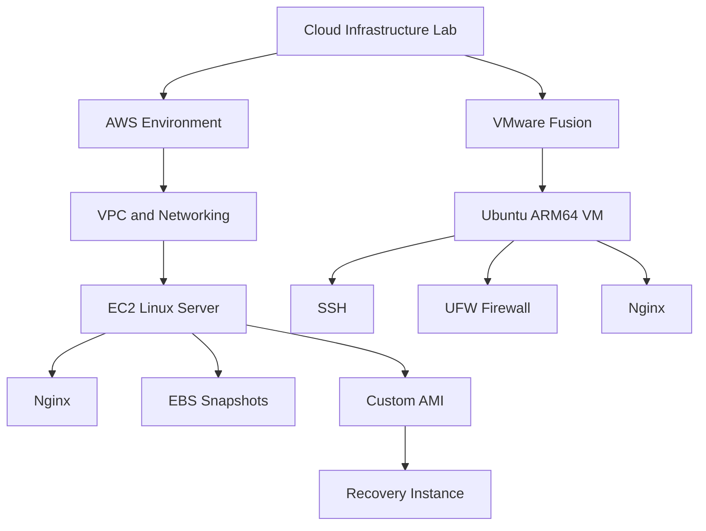
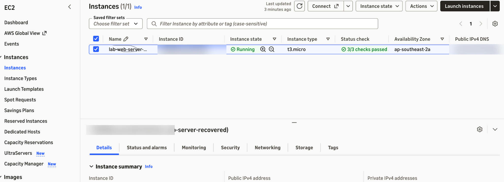
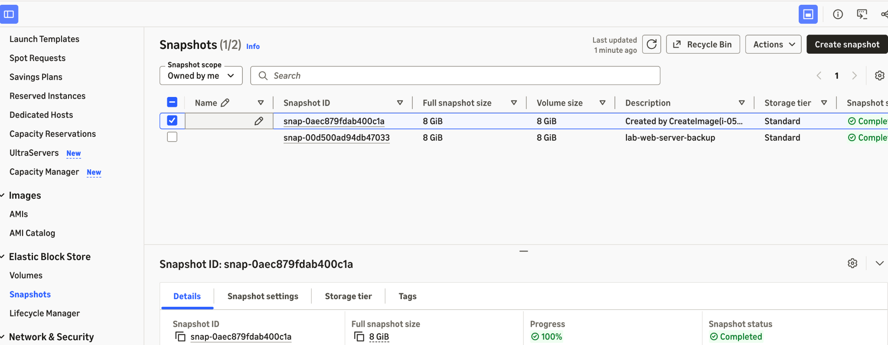
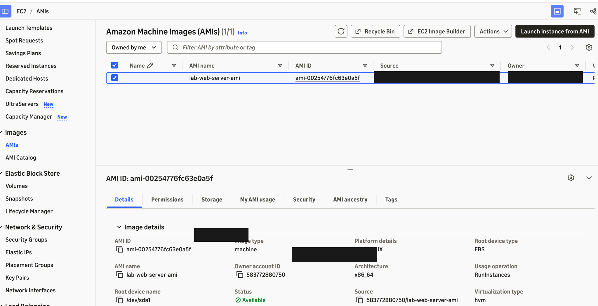
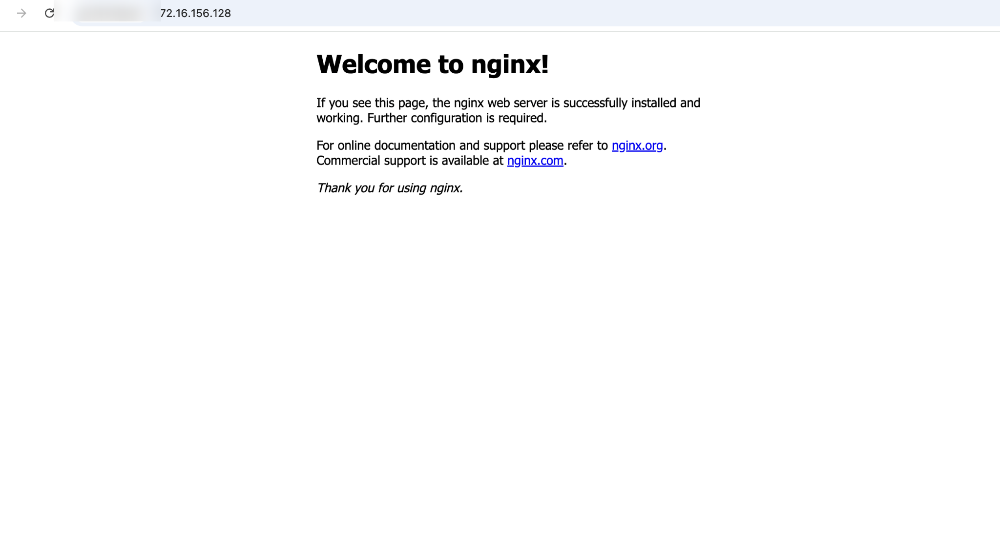
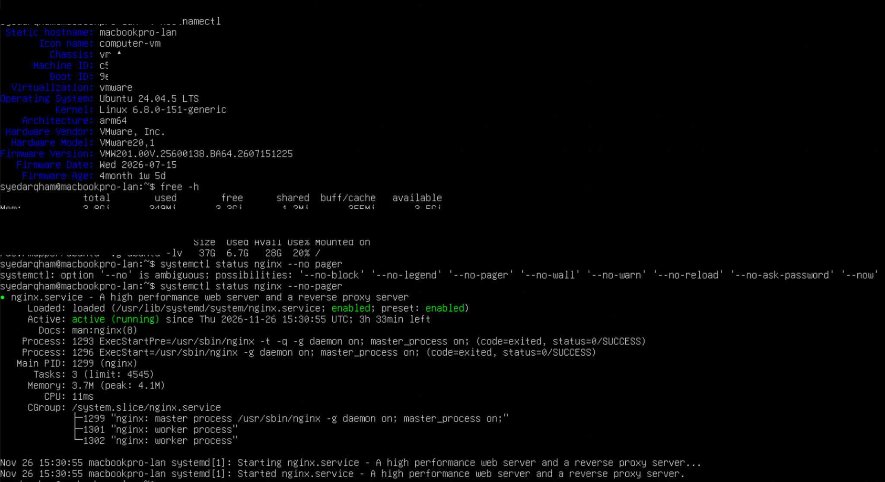

# Cloud Infrastructure, Backup & Disaster Recovery Lab

## Overview

A hands-on infrastructure and cloud support lab designed to demonstrate practical knowledge of virtualization, AWS infrastructure, backup and recovery, Linux administration, incident troubleshooting and root cause analysis.

This project combines an AWS environment with a VMware Fusion virtual machine to explore infrastructure operations and recovery scenarios.

## Objectives

- Provision and manage cloud infrastructure using AWS.
- Understand virtualization through VMware Fusion.
- Configure and operate Linux servers.
- Understand backup and recovery workflows.
- Simulate infrastructure failures and investigate root causes.
- Restore infrastructure following failure scenarios.
- Document troubleshooting procedures and technical findings.

## Architecture

## Technologies

| Technology | Purpose |
|---|---|
| AWS EC2 | Cloud compute infrastructure |
| Amazon VPC | Virtual networking |
| Security Groups | Network access control |
| Amazon EBS | Block storage |
| EBS Snapshots | Storage backup simulation |
| Amazon Machine Images (AMI) | Instance recovery |
| Ubuntu Linux | Server operating system |
| Nginx | Web server |
| VMware Fusion | Local virtualization |
| SSH | Remote server administration |
| UFW | Linux firewall |
| LVM | Logical volume management |

## 1. AWS Infrastructure (IaaS)

Provisioned and configured an AWS infrastructure environment.

### Implemented

- Created a custom VPC.
- Configured a public subnet.
- Configured a Security Group.
- Provisioned an EC2 Linux server.
- Installed and configured Nginx.
- Verified HTTP connectivity.
- Investigated network access failures.

## 2. Backup Simulation (BaaS Concepts)

Explored AWS storage backup concepts and image-based recovery.

### Implemented

- Created EBS snapshots.
- Created a custom Amazon Machine Image (AMI).
- Used AWS backup resources as part of recovery preparation.

## 3. Disaster Recovery Simulation (DRaaS Concepts)

Simulated infrastructure failure and recovery using AWS EC2 and AMI-based recovery.

### Implemented

- Prepared an AMI for recovery.
- Simulated the loss of an EC2 instance.
- Provisioned a recovery instance using the prepared image.
- Verified the recovered server.

### Cross-Region Investigation

Attempted cross-region AMI copying.

The operation was restricted by an AWS Service Control Policy (SCP) explicitly denying the `ec2:CopyImage` action.

This limitation was investigated and documented rather than bypassed.

## 4. VMware Virtualization & Linux Administration

Created and operated an Ubuntu Server virtual machine using VMware Fusion on Apple Silicon.

### Configuration

| Resource | Configuration |
|---|---|
| Hypervisor | VMware Fusion |
| Guest OS | Ubuntu Server ARM64 |
| CPU | 2 cores |
| Memory | 4 GB |
| Virtual disk | 40 GB |
| Storage management | LVM |
| Network | VMware Shared Networking |

### Implemented

- Installed Ubuntu Server.
- Configured VM hardware resources.
- Expanded the Linux root logical volume using LVM.
- Configured SSH access.
- Installed and verified Nginx.
- Configured UFW firewall rules.
- Verified host-to-VM HTTP connectivity.
- Verified DNS and internet connectivity.

## 5. Incident Troubleshooting & Root Cause Analysis

### Incident 1 — HTTP Connectivity Failure

**Problem:** HTTP access to the server was blocked.

**Investigation:** Examined network access configuration.

**Root cause:** Security Group configuration did not permit HTTP traffic on port 80.

**Resolution:** Corrected the Security Group rule and verified HTTP connectivity.

### Incident 2 — Nginx Service / Configuration Failure

**Problem:** Web service functionality was disrupted.

**Investigation:** Investigated the Nginx service and configuration.

**Resolution:** Identified and corrected the issue, then verified service functionality.

### Incident 3 — EC2 Instance Loss

**Problem:** The original EC2 instance was terminated as part of a recovery simulation.

**Recovery:** Provisioned a replacement instance using the prepared AMI.

**Verification:** Validated the recovered infrastructure and web service.

## 6. Infrastructure Verification

Linux operational commands used during the lab:

| Command | Purpose |
|---|---|
| `ip addr` | Inspect network interfaces and IP addresses |
| `free -h` | Check memory |
| `nproc` | Check CPU count |
| `df -h` | Check filesystem capacity |
| `lsblk` | Inspect disks and partitions |
| `sudo vgs` | Inspect LVM volume groups |
| `systemctl status nginx` | Check web service status |
| `systemctl --failed` | Inspect failed systemd services |
| `sudo ufw status` | Inspect firewall rules |
| `ping -c 4 google.com` | Verify connectivity and DNS |

## 7. Skills Demonstrated

- Cloud infrastructure provisioning
- AWS EC2 operations
- Virtual networking
- Security Group troubleshooting
- Linux administration
- VMware virtualization
- SSH administration
- Linux firewall configuration
- LVM storage management
- Backup concepts
- AMI-based recovery
- Disaster recovery simulation
- Root cause analysis
- Technical investigation
- Infrastructure documentation

## Project Status

This project is an ongoing hands-on lab. The AWS infrastructure, backup preparation, AMI-based recovery simulation, troubleshooting exercises and VMware Ubuntu foundation have been implemented.

Additional evidence and documentation will be added as the lab is consolidated.

---

**Disclaimer:** This is a personal learning and simulation project. It is not a production cloud environment or an implementation of a commercial BaaS or DRaaS platform.

## Project Screenshots

### 1. AWS EC2 Recovery

### 2. AWS EBS Backup Snapshot

### 3. AWS AMI

### 4. Nginx Web Server from Mac

### 5. VMware Ubuntu

